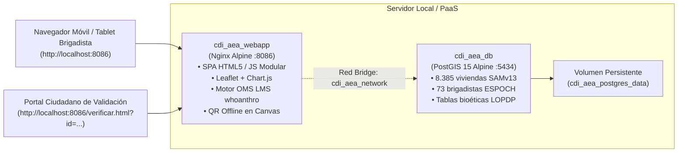

# Sistema de Información Georreferenciada para la Caracterización de la Población Infantil (0 a 5 años) en San Andrés

[](.github/workflows/ci.yml)
[](CHANGELOG.md)
[](docker-compose.yml)
[](database/init_dci_geodb.sql)
[](app/js/anthro_who.js)
[](tests/)

---

## 1. Visión General del Proyecto

Plataforma de alta precisión técnica y rigor bioestadístico desarrollada en el marco del **Convenio de Cooperación Interinstitucional entre la Escuela Superior Politécnica de Chimborazo (ESPOCH) y la Fundación Ayuda en Acción Ecuador**, financiado por la **Unión Europea**.

- **Componente:** A.3.1 — Caracterización Georreferenciada de la Población Infantil (0 a 5 años).
- **Territorio Activo:** Parroquia San Andrés, Cantón Guano, Provincia de Chimborazo, Ecuador.
- **Muestra Objetivo:** **1.397 niños y niñas entre 0 y 5 años** (0 a 59 meses cumplidos).
- **Catastro Base:** 8.385 viviendas georreferenciadas (modelo de segmentación territorial SAMv13).
- **Equipo Operativo:** 73 estudiantes de Nutrición y Dietética ESPOCH organizados en 36 duplas operativas + 1 logística central, certificadas bajo el estándar de Error Técnico de Medición (TEM).

---

## 2. Arquitectura Tecnológica Multicontenedor



---

## 3. Motor Antropométrico OMS (`whoanthro` / LMS)

El sistema integra de forma nativa la metodología **LMS (Cole & Green)** del *WHO Child Growth Standards (2006)* y el paquete R `anthro`:
1. **Indicadores de Crecimiento:**
   - **HAZ / ZLEN (Talla para la Edad):** Identificación de Desnutrición Crónica Infantil (DCI moderada $Z < -2$, severa $Z < -3$).
   - **WAZ / ZWFA (Peso para la Edad):** Desnutrición Global.
   - **WHZ / ZWFL (Peso para la Talla):** Desnutrición Aguda (Emaciación) y Sobrepeso/Obesidad.
   - **BAZ / ZBMI (IMC para la Edad):** Composición corporal.
2. **Corrección Posicional OMS:**
   - Si niño $< 24$ meses fue medido de pie: se suma $+0.7\text{ cm}$.
   - Si niño $\ge 24$ meses fue medido acostado: se resta $-0.7\text{ cm}$.
3. **Protocolo ante Edema Bilateral Nutricional:** Clasifica automáticamente como Desnutrición Aguda Severa (SAM / Kwashiorkor) e invalida los z-scores de peso para no enmascarar la emaciación.
4. **Banderas de Plausibilidad Biológica (Biological Flags):** Alertas ante valores extremos físicos ($\text{HAZ} \notin [-6, 6]$, $\text{WAZ} \notin [-6, 5]$, $\text{WHZ} \notin [-5, 5]$).

---

## 4. Guía de Inicio Rápido (3 Comandos)

```bash
# 1. Configurar variables de entorno Twelve-Factor
cp .env.example .env

# 2. Levantar el stack multicontenedor con Docker
make up
# (o: docker compose up -d)

# 3. Ejecutar la suite de pruebas unitarias OMS
make test
# (o: node tests/run_all_tests.js)
```

Acceso al sistema:
- **Web App Operativa:** `http://localhost:8086/`
- **Portal de Verificación Pública:** `http://localhost:8086/verificar.html?id=ESPOCH-BRIG-09`
- **Base de Datos PostGIS:** `localhost:5434` (Base: `dci_geodb`, Usuario: `dci_user`)

---

## 5. Matriz de Roles y Accesos (RBAC 2.0)

| Rol Institucional | Usuario de Acceso | Contraseña | Módulos Autorizados |
|:---|:---|:---|:---|
| **Administrador / CIO** | `admin@dci.ec` | `admin123` | Acceso irrestricto (9 módulos, usuarios y reportes) |
| **Supervisor de Campo** | `supervisor@dci.ec` | `supervisor123` | Dashboard, GIS, KoBo, Brigadistas, Población, Credenciales |
| **Encuestador (Dupla)** | `encuestador@dci.ec` | `encuestador123` | GIS, Protocolos, Brigadistas, Credenciales QR |
| **Nutricionista** | `nutricionista@dci.ec` | `nutri123` | GIS, Protocolos, Población Infantil, Credenciales QR |
