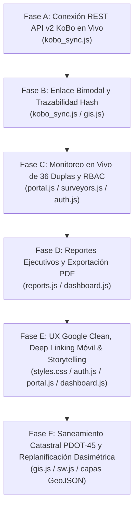

# Plan de Desarrollo Futuro: Plataforma Web CGPI San Andrés (APP DCI)
**Componente A.3.1 - Proyecto DCI (Ayuda en Acción Ecuador / ESPOCH)**  
*Hoja de Ruta Técnica para Sub-Agentes (`@web-engineer`, `@systems-architect`, `@data-scientist`)*  
*Versión:* **v2.5.0 (Despliegue Operativo Bimodal y Conexión KoBo API v2)**

---

## 1. Visión y Objetivos del Ciclo de Desarrollo Web

Este plan de desarrollo establece las directrices de ingeniería para consolidar la **Plataforma Web CGPI San Andrés (APP DCI)** como el centro neurálgico de operaciones del levantamiento de la muestra probabilística de **647 niños menores de 5 años** en San Andrés (Etapa Actual, 45 Asentamientos Humanos Oficiales PDOT Guano 2023–2027) y 750 niños en Manglaralto (Segunda Etapa, para un total contractual de 1,397 niños), bajo un esquema operativo concentrado en 5 jornadas de lunes.

El ciclo de desarrollo está organizado en fases consecutivas:

---

## 2. Fases de Desarrollo Planificadas

### Fase A: Conexión REST API v2 en Vivo con KoBoToolbox (`kobo_sync.js`)
*   **Diagnóstico:** Actualmente, la interfaz cuenta con un mock generator que produce envíos simulados para pruebas de UI y persistencia básica en `LocalStorage`.
*   **Objetivo de Ingeniería:** Conectar el módulo `kobo_sync.js` directamente a los dos activos de producción en `https://kf.kobotoolbox.org` mediante peticiones `fetch` autenticadas con el token institucional (`Token 2110c7974bc850dfd236052309f3aeaf17fa1d61`).
*   **Entregables:**
    1.  Mapeo de endpoints de producción:
        *   Antropometría: `/api/v2/assets/aqFmM2CfVF9N7PaUQeYVux/data.json`
        *   Caracterización del Hogar: `/api/v2/assets/awxjbYsJnZZ4uUJZs4w2wF/data.json`
    2.  Paginación e ingesta incremental con almacenamiento en `IndexedDB` para soportar cientos de registros sin saturar el límite de 5 MB de `LocalStorage`.
    3.  Botón de acción en la barra de navegación: "Sincronizar KoBo Ahora", con indicador de estado (en línea / desconectado / sincronizando) y timestamp del último barrido exitoso.

### Fase B: Enlace Bimodal y Trazabilidad Hash SHA-256 en Cliente (`kobo_sync.js` & `gis.js`)
*   **Contexto Bioético y Metodológico:** La captura de datos de campo se ejecuta mediante dos XLSForms desacoplados para cumplir con las exigencias del CEISH-ESPOCH.
*   **Objetivo de Ingeniería:** Implementar la lógica client-side que realice el matching relacional (1 a N) entre los hogares caracterizados y los niños medidos:
    *   Hogar: `uid_hogar_hash` (generado a partir de provincia, cantón, parroquia, sector, comunidad, predio y hogar).
    *   Infante: `uid_infante_hash` y referencia a `uid_hogar_hash`.
*   **Entregables:**
    1.  Motor de conciliación: Detección y semáforo de inconsistencias:
        *   *Verde (Completado):* Hogar caracterizado con todas sus mediciones infantiles vinculadas.
        *   *Amarillo (Incompleto):* Hogar reporta infantes pero falta la ficha antropométrica, o viceversa.
        *   *Rojo (Huérfano):* Medición infantil con `uid_hogar_hash` no localizado en el padrón de hogares.
    2.  Integración cartográfica en `gis.js`: Capas alternables en Leaflet para ver el estado de cobertura predial bimodal en las 51 comunidades.

### Fase C: Monitoreo en Vivo de las 36 Duplas y Matriz RBAC 2.0 (`portal.js`, `surveyors.js`, `auth.js`)
*   **Contexto Operativo:** 73 brigadistas politécnicos en 36 duplas + 1 logística central, distribuidos en 3 macro-sectores (A, B, C) con 3 docentes supervisores.
*   **Objetivo de Ingeniería:**
    1.  Adaptar `auth.js` para reconocer las sesiones de los 73 estudiantes con sus correos politécnicos `@espoch.edu.ec` cargados desde `app/data/brigadistas_espoch_dci.json`.
    2.  En `portal.js`, autodetectar la dupla autenticada (ej: `D01`), calculando dinámicamente su meta asignada (~18 niños por dupla, en 5 jornadas de lunes; meta total parroquial: 647 niños) y mostrando los envíos registrados por su dupla en KoBoToolbox.
    3.  En `surveyors.js`, mostrar el directorio completo de las 36 duplas con filtros reactivos por macro-sector (A: Urbano, B: Eje Vial, C: Altas), búsqueda instantánea y estado de calibración SECA.
    4.  Módulo de verificación de calibración diaria matutina de balanzas SECA 874 ($\le 50\text{ g}$) con registro para los supervisores.

### Fase D: Reportes Ejecutivos, Tableros Analíticos y Exportación PDF (`reports.js` & `dashboard.js`)
*   **Objetivo de Ingeniería:** Proporcionar herramientas de reportería gerencial y médica para la Coordinación de Ayuda en Acción y la ESPOCH.
*   **Entregables:**
    1.  Tablero de alertas clínicas (*Banderas Rojas MSP*): Desnutrición aguda severa ($WHZ < -3\text{ DE}$ o presencia de edema bilateral), generando ficha de derivación al Centro de Salud San Andrés tipo B.
    2.  Reporte consolidado de avance muestral semanal desagregado por comunidad y sector.
    3.  Generación e impresión de informe técnico con membrete institucional oficial (Logos Ayuda en Acción, ESPOCH, Unión Europea), estadísticas de cobertura y firmas de validación técnica.

### Fase E: Experiencia de Usuario Google Clean Style, Deep Linking Móvil y Storytelling Analítico (`styles.css`, `auth.js`, `portal.js`, `dashboard.js`)
*   **Diagnóstico:** La versión inicial en producción posee fondos y encabezados con degradados marrones oscuros que merman la legibilidad en pantallas móviles en campo bajo luz solar directa. Asimismo, los brigadistas requieren acceso directo a la app KoBoCollect instalada en sus dispositivos Android o escanear códigos QR en pantalla, y el Dashboard requiere estructurarse bajo una narrativa epidemiológica comprensible para directivos.
*   **Objetivo de Ingeniería:** Migrar la plataforma hacia el estándar visual **Google Material 3 / Clean UI**, habilitar enlace profundo nativo para Android / visor de QR client-side y transformar el Dashboard en un relato en 4 actos con conclusiones técnicas explícitas.
*   **Entregables:**
    1.  **Refactorización Estética Google Clean Style (`styles.css` & `auth.js`):**
        *   Eliminación sistemática de gradientes oscuros (`#1a1210`, `#2e201b`, `#2D1A12`, `#3C2415`).
        *   Paleta luminosa: fondo Google Surface `#F8F9FA`, tarjetas blancas `#FFFFFF`, bordes sutiles `#E0E2EC` y elevaciones suaves L1/L2.
        *   Rediseño del Login estilo *Google Sign-In* con *Segmented Buttons* e inputs *Google Outlined*.
    2.  **Deep Linking Nativo KoBoCollect y Extractor de Códigos QR (`portal.js`):**
        *   Detección reactiva de dispositivos Android para presentar el botón `📱 Abrir en KoBoCollect` vía Intent nativo (`org.koboc.collect.android`).
        *   Enlace alternativo web `🌐 Abrir en Enketo Web`.
        *   Modal extractor de Códigos QR client-side (vía `qrcode.min.js`) para escaneo instantáneo entre brigadistas con tablets.
    3.  **Dashboard con Data Storytelling Epidemiológico en 4 Actos (`dashboard.js`):**
        *   *Acto 1 (El Reto):* Avance hacia la meta parroquial de 647 niños (Sector A: 221, Sector B: 230, Sector C: 196) con contexto de la meta biparrioquial de 1,397 niños, y avance por jornadas de lunes.
        *   *Acto 2 (El Diagnóstico):* Carga de DCI comparada con Chimborazo (35.1%) y Nacional (20.1%), curva gaussiana OMS y ventana crítica de los 1,000 días.
        *   *Acto 3 (La Causa Raíz):* Brechas de agua segura (42% red vs 58% sin tratamiento) e inseguridad alimentaria FIES.
        *   *Acto 4 (La Acción Inmediata):* Triaje de Banderas Rojas MSP para derivación urgente y bitácora de calibración SECA.
        *   Micro-bloques de *Takeaways* destacados en cada acto con conclusiones de salud pública.

### Fase F: Saneamiento Catastral PDOT-45 y Replanificación Dasimétrica Espacial (`gis.js`, `sw.js`, `comunidades_oficiales_pdot_san_andres.geojson`, `san_andres_viviendas.geojson`)
*   **Diagnóstico:** Auditorías técnicas de campo y cruces con el PDOT Cantón Guano 2023–2027 revelaron que las capas anteriores incluían asentamientos pertenecientes a otras parroquias (San Isidro de Patulú) o cantones. El Product Owner depuró el marco territorial consolidando exactamente **45 Asentamientos Humanos Oficiales** y **5,486 techos habitacionales dasimétricos** clasificados por K-NN sobre la población del Censo INEC 2022 (13,154 hab, DCI 38.96%).
*   **Objetivo de Ingeniería:** Conectar el módulo `gis.js` a las nuevas capas GeoJSON oficiales, actualizar el selector de asentamientos con los 45 nombres oficiales agrupados en los 3 Macro-Sectores (A: 16, B: 14, C: 15), enriquecer los modales informativos con el equipamiento real del PDOT (pp. 475-478) y precachear los nuevos archivos en el Service Worker (`sw.js`).
*   **Entregables:**
    1.  Carga de `app/data/gis/comunidades_oficiales_pdot_san_andres.geojson` y `app/data/gis/san_andres_viviendas.geojson` en el visor Leaflet.
    2.  Filtro interactivo multinivel por Macro-Sector y por Asentamiento Oficial (45 opciones).
    3.  Popups informativos con autoridades comunitarias estandarizadas bajo protocolo `[Por confirmar en territorio con Cabildo Comunal / GAD]`.
    4.  Actualización de `sw.js` a la versión `v2.6.1` para almacenamiento en caché offline de las nuevas capas vectoriales.

