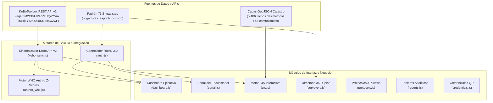

# Producto de Software: Plataforma Web CGPI San Andrés (APP DCI)
**Componente A.3.1 - Proyecto DCI (Ayuda en Acción Ecuador / ESPOCH)**  
*Muestra Objetivo San Andrés (Etapa Actual):* 647 niños menores de 5 años (Muestra Total Contrato: 1,397 con Manglaralto) | *Operativo:* 5 Jornadas de Lunes  
*Versión Oficial:* **v2.5.0 (Despliegue Bimodal, API v2 KoBoToolbox y Padrón 73 Brigadistas)**

---

## 1. Visión y Alcance del Producto

La **Plataforma Web CGPI San Andrés** es una aplicación web progresiva (PWA) de monitoreo territorial, aseguramiento de calidad estadística, auditoría bioética y control epidemiológico en tiempo real. Está diseñada para operar tanto en línea como en condiciones de desconexión absoluta (*Offline-First*) en los 45 Asentamientos Humanos Oficiales de la parroquia de San Andrés (Chimborazo, PDOT Guano 2023–2027) y las comunas de Manglaralto (Santa Elena).

El sistema articula el trabajo de campo de **73 estudiantes politécnicos de Nutrición y Dietética** (organizados en **36 duplas operativas** + 1 soporte logístico central), **3 docentes supervisores de la Facultad de Salud Pública de la ESPOCH** y la **Coordinación Técnica del Proyecto**, garantizando que cada registro antropométrico y sociodemográfico cumpla con los estándares de rigor del Modelo de Producción Estadística (MPE 2.0 - INEC) y el protocolo bioético CEISH-ESPOCH.

---

## 2. Perfiles de Usuario y Matriz RBAC 2.0

La plataforma implementa un control de acceso basado en roles (RBAC 2.0) integrado con las identidades institucionales de la ESPOCH (`@espoch.edu.ec`):

| Rol de Usuario | Identidad / Acceso | Alcance y Vistas Permitidas | Capacidades Clave |
| :--- | :--- | :--- | :--- |
| **Estudiante Encuestador (Dupla)** | 73 brigadistas politécnicos (`@espoch.edu.ec`) | Panel personal (`portal.js`), GIS de su cuadrante (`gis.js`), credencial QR (`credentials.js`). | • Monitoreo de meta personal de dupla (meta media: ~18 infantes por dupla, ~4 a 5 por jornada de lunes; total San Andrés: 647 niños). • Enlaces directos a formularios Enketo Web (Antropometría y Caracterización). • Consulta de predios asignados en el mapa sin conexión. • Generación y validación de credencial QR oficial para autoridades comunitarias. |
| **Docente Supervisor de Campo** | 3 docentes titulares FSP (`veronica.delgado@`, `vilma.velasco@`, `patricio.ramos@`) | Sector bajo su mando: Sector A (D01-D12), Sector B (D13-D24) o Sector C (D25-D36). | • Monitoreo en tiempo real del avance de sus 12 duplas. • Validación diaria del protocolo de calibración matutina de balanzas y tallímetros SECA ($\le 50\text{ g}$). • Auditoría de concordancia TEM (Error Técnico de Medición). • Gestión y triaje de alertas clínicas inmediatas de desnutrición aguda severa (*Banderas Rojas MSP*). |
| **Coordinador Técnico / Investigador** | Coordinación técnica (`coordinador@espoch.edu.ec`) | Cobertura global parroquial (45 asentamientos oficiales, 5,486 techos dasimétricos, meta San Andrés: 647 niños / 1,397 total contrato). | • Tablero gerencial unificado de cobertura y avance respecto a la muestra objetivo. • Curvas y distribución de puntajes Z OMS (HAZ, WAZ, WHZ, BAZ). • Pirámide poblacional desagregada por rangos etarios críticos (<6m, 6-23m, 24-59m). • Auditoría de completitud del enlace bimodal (Hogares vs Antropometría). |
| **Administrador / CIO** | Dirección de sistemas (`admin@espoch.edu.ec`) | Configuración total, conectividad e infraestructura. | • Configuración y prueba de endpoints REST API v2 de KoBoToolbox. • Gestión del token institucional y sincronización en segundo plano. • Auditoría de integridad del Hash Criptográfico SHA-256 / Módulo 10. • Gestión del padrón de brigadistas y sincronización con Microsoft Teams M365. |

---

## 3. Arquitectura de Módulos Funcionales

### Especificación Detallada de Módulos:

1.  **Dashboard Ejecutivo (`dashboard.js`):**
    *   Indicadores clave en tiempo real: Total de registros levantados, porcentaje de cumplimiento hacia la meta de 647 niños de San Andrés (y 1,397 a nivel global con Manglaralto), tasa de desnutrición crónica preliminar ($T/E < -2\text{ DE}$), desglose por macro-sector (Sector A: 221, Sector B: 230, Sector C: 196) y estado de sincronización.
2.  **Portal del Encuestador (`portal.js`):**
    *   Diseñado para teléfonos y tablets. Muestra la dupla autenticada (ej: `D01`), nombres de los 2 titulares, supervisor asignado, niños levantados en el día, checklist de calibración SECA y accesos directos de 1 clic a los formularios de Enketo Web:
        *   *Formulario Antropometría:* `https://ee.kobotoolbox.org/XnLSvL66`
        *   *Formulario Caracterización del Hogar:* `https://ee.kobotoolbox.org/rrNpxrAR`
3.  **Sistema de Información Geográfica Bimodal (`gis.js`):**
    *   Motor Leaflet.js optimizado para renderizar los 5,486 techos habitacionales dasimétricos clasificados por proximidad espacial K-NN. Permite alternar capas:
        *   Capa de Hogares Caracterizados (puntos azules/verdes según completitud).
        *   Capa de Mediciones Antropométricas (puntos naranjas vinculados por `uid_hogar_hash`).
        *   Polígonos y puntos de los 45 Asentamientos Humanos Oficiales (PDOT Guano 2023–2027) con semáforo de cobertura muestral.
        *   Límites de los macro-sectores A, B y C.
4.  **Sincronización KoBoToolbox (`kobo_sync.js`):**
    *   Cliente HTTP REST API v2 que consulta los dos activos en `kf.kobotoolbox.org`. Realiza el matching en cliente utilizando `uid_infante_hash` y `uid_hogar_hash`, valida la integridad de los datos, detecta duplicados y almacena la información consolidada en `LocalStorage` e `IndexedDB`.
5.  **Padrón de Brigadistas y Supervisores (`surveyors.js`):**
    *   Directorio interactivo de los 73 estudiantes politécnicos organizados en las 36 duplas y 3 sectores. Incluye buscador reactivo por nombre, cédula, dupla, código institucional y correo institucional (`@espoch.edu.ec`), visualización de teléfonos de soporte y estado de acreditación TEM.
6.  **Motor Antropométrico WHO Anthro (`anthro_who.js`):**
    *   Implementación completa en JavaScript de las tablas y fórmulas LMS de los Patrones de Crecimiento Infantil de la OMS (2006). Calcula con precisión de 4 decimales:
        *   Longitud/Talla para la Edad ($HAZ$)
        *   Peso para la Edad ($WAZ$)
        *   Peso para la Longitud/Talla ($WHZ$)
        *   Índice de Masa Corporal para la Edad ($BAZ$)
7.  **Biblioteca de Protocolos & Diálogos Kichwa (`protocols.js`):**
    *   Visor de procedimientos estandarizados: consentimiento informado CEISH, técnica de medición con tallímetro/infantómetro SECA 417, técnica de pesaje con SECA 874 (función Madre/Hijo), banderas rojas de derivación médica y glosario fonético interactivo Kichwa Puruhá para el trabajo en comunidades indígenas.
8.  **Generador de Credenciales Oficiales QR (`credentials.js` & `verificar.html`):**
    *   Emisión de carnets digitales institucionales con código QR firmado que contiene la URL pública de validación (`verificar.html?id=ESPOCH-BRIG-XX`). Permite a presidentes de cabildos y familias escanear y verificar la autenticidad del brigadista en campo.

---

## 4. Especificación Visual y de Interfaz: Google Clean Style & Data Storytelling

### 4.1 Sistema de Diseño Google Clean Style (Material 3 / Google Workspace)
*   **Filosofía Visual:** Máxima claridad visual, eliminación radical de fondos y apartados con degradados marrones oscuros, optimización para lectura bajo el sol en campo andino y adopción del lenguaje visual de Google Workspace:
    *   *Fondo General:* Google Surface Container `#F8F9FA`.
    *   *Superficies de Tarjetas:* Blanco Puro `#FFFFFF` con esquinas redondeadas de `16px` a `24px` y bordes sutiles de `1px solid #E0E2EC`.
    *   *Sistema de Elevación:* Sombras suaves multinivel (Google Elevation L1 y L2) para jerarquizar información sin generar ruido visual.
    *   *Pantalla de Autenticación:* Tarjeta blanca centrada (`max-width: 440px`, radio `28px`, borde `#DADCE0`), pestañas de rol tipo *Segmented Buttons*, inputs estilo *Google Outlined* con focus ring de 2px y botones estilo *Google Pill* (`border-radius: 100px`).

### 4.2 Arquitectura de Acceso Móvil Bimodal y Códigos QR
*   **Enlace Profundo KoBoCollect (Android Intent):**
    *   En dispositivos Android (`/Android/i.test(navigator.userAgent)`), el sistema presenta prioritariamente el botón nativo de apertura de la app KoBoCollect:
        `intent:#Intent;package=org.koboc.collect.android;action=android.intent.action.MAIN;category=android.intent.category.LAUNCHER;end`
    *   Permite a los brigadistas saltar directamente a la app nativa instalada, optimizada para captura offline en campo sin depender del navegador.
*   **Enketo Web Alternativo:**
    *   Enlace accesible para ordenadores de escritorio o dispositivos sin la app instalada.
*   **Modal Extractor de Códigos QR:**
    *   Renderizado dinámico client-side (vía `qrcode.min.js`) de códigos QR de ambos formularios para enrolamiento y escaneo rápido entre tablets y teléfonos del equipo de campo.

### 4.3 Marco de Data Storytelling Epidemiológico en el Dashboard
*   El Dashboard ejecutivo (`dashboard.js`) se organiza bajo una estructura narrativa en **4 Actos**:
    1.  **Acto 1: Despliegue Territorial y Avance de la Meta:** Contexto de la meta de San Andrés (647 niños) y global del convenio (1,397 niños con Manglaralto), cobertura por macro-sectores (Sector A: 221, Sector B: 230, Sector C: 196) y avance de las 36 duplas (~18 niños por dupla, organizados en 5 jornadas de lunes). *Takeaway de dispersión geográfica y adaptación a la rutina rural*.
    2.  **Acto 2: Carga de la Desnutrición Crónica y Curva OMS:** Diagnóstico nutricional comparativo frente a Chimborazo (35.1%) y Ecuador (20.1%), curva gaussiana OMS ($HAZ$) y análisis de la ventana crítica de los primeros 1,000 días (<6m, 6-23m, 24-59m). *Takeaway de desaceleración del crecimiento*.
    3.  **Acto 3: Determinantes Sociales Críticos:** Factores causales de saneamiento, acceso a agua segura clorada (42% red vs 58% fuentes sin tratamiento) e inseguridad alimentaria FIES. *Takeaway de riesgo biológico y diarreico*.
    4.  **Acto 4: Alertas Clínicas y Acción Inmediata:** Monitoreo y triaje de Banderas Rojas MSP ($WHZ < -3\text{ DE}$, edema) para derivación urgente y control de calidad de calibración de balanzas SECA ($\le 50\text{ g}$).

